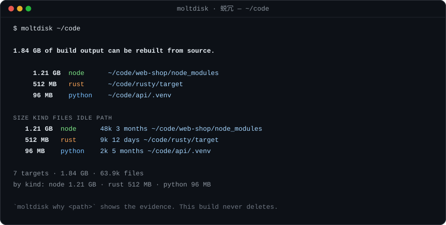

# moltdisk · 蜕冗

[](https://github.com/yangyang2857-rgb/moltdisk/actions/workflows/ci.yml)
[](https://github.com/yangyang2857-rgb/moltdisk/releases)
[](LICENSE)
[](Cargo.toml)

**蜕冗** — 蜕去冗余。Shed your dev bulk by finding it, not by deleting it.

`moltdisk` 只做一件事：告诉你哪些构建产物是可以从源码重建的，以及凭什么这么判断。它不删任何东西。

`moltdisk` walks your projects and finds build output that can be rebuilt from source:
`node_modules`, `target`, `dist`, `venv`, `Pods`, caches. It measures how much disk
they occupy, ranks them, and explains *why* it believes each one is disposable.

Then it stops. This build has no delete code path.



```
$ moltdisk ~/code
1.84 GB of build output can be rebuilt from source.

7 targets  ·  1.84 GB  ·  63.9k files
by kind: node 1.21 GB  ·  rust 512 MB  ·  python 96 MB

`moltdisk why <path>` shows the evidence for any entry. This build never deletes — that call is yours.
```

## 名字

`molt` 是爬行动物蜕去旧壳的动作，`蜕冗` 是蜕去冗余，`disk` 是要蜕的那层壳。
构建产物本来就是这样一层壳：每年重生成几十次，删掉一次都不该心疼。
工具的职责是告诉你哪一层壳是可以蜕的，以及凭什么——壳要不要蜕，是人决定的。

## Why an auditor and not a deleter

An early internal build of `moltdisk` could delete. It had guard rails: a directory
only counted as build output when its *name and a sibling marker* both matched
(`target/` needed a `Cargo.toml` beside it, `vendor/` a `composer.json`, `Pods/` a
`Podfile`), and it refused symlinks, the home directory, and anything outside the
given roots.

Those guards were good and they were not enough. A tool that deletes other people's
build directories from a heuristic is a tool that will one day delete the wrong
thing, and the person holding the keyboard will not be the person who wrote the
heuristic. So the deleting was removed before this project was ever published. What
is left is the part that was always the interesting part: the judgement, shown in
the open.

If you want the deletions, do them yourself, with the list `moltdisk` hands you. You
know your projects. `moltdisk` only knows its rulebook.

There is no `delete` module, no `remove_dir_all` call, and `-y` is a hard error:

```
$ moltdisk -y
moltdisk: this build never deletes — `-y` was removed in 0.1.0 (see `moltdisk --help`)
```

You do not have to take that on faith:

```bash
cargo build --release
grep -c remove_dir_all src/*.rs      # only matches inside #[cfg(test)] cleanup
strings target/release/moltdisk | grep -c remove_dir_all   # 0
```

## Install

Prebuilt binaries are attached to [each release](https://github.com/yangyang2857-rgb/moltdisk/releases):
Linux x86_64 / aarch64 (static musl), macOS Intel / Apple Silicon, Windows x86_64.
Each archive is paired with a `.sha256`.

```bash
TAG=v0.1.0
curl -LO https://github.com/yangyang2857-rgb/moltdisk/releases/download/$TAG/moltdisk-$TAG-x86_64-unknown-linux-musl.tar.gz
sha256sum -c moltdisk-$TAG-x86_64-unknown-linux-musl.sha256
tar xzf moltdisk-$TAG-x86_64-unknown-linux-musl.tar.gz
```

Or from source:

```bash
cargo install --git https://github.com/yangyang2857-rgb/moltdisk
```

MSRV is 1.80. One dependency (`rayon`), no `unsafe`.

## Usage

```
moltdisk [paths...] [options]     # report on these paths (default: .)
moltdisk why <path>               # explain one verdict, with its evidence
moltdisk kinds                    # the rulebook
```

| Option | Meaning |
| --- | --- |
| `-k, --kind <list>` | restrict to some kinds (`node,rust,jvm,...`) or `all` |
| `-s, --min-size <size>` | ignore piles smaller than this (`500mb`, `1gb`) |
| `-t, --older-than <age>` | only untouched this long (`30d`, `12h`) |
| `-d, --depth <n>` | how deep to walk from each root (default 8) |
| `--jobs <n>` | measuring threads (default: available parallelism) |
| `--json` | machine-readable report on stdout |
| `--no-color` | no ANSI colour (also honours `NO_COLOR`) |
| `-q, --quiet` | no progress chatter |

Colour is disabled automatically when stdout is not a terminal, so piping to
`jq` or a file is safe.

## How a verdict is reached

A name is not evidence. `target/` is an ordinary English word, and a folder called
`target` full of source files is not build output. So every rule demands two things:

1. the directory (or file) name matches, **and**
2. a sibling marker exists that only a real project of that kind would have.

`moltdisk why` prints both halves, including the marker it looked for when nothing
matched:

```
$ moltdisk why web-shop/target
~/code/web-shop/target

  verdict   not build output
  reason    the name matched, but no marker was satisfied:
    · Rust needs Cargo.toml — not found
    · JVM needs pom.xml or build.gradle — not found

Looks like an ordinary directory or file. Without the marker, the name alone is not evidence.
```

## The rulebook

`moltdisk kinds` prints this table with the rebuild line for each entry — that line is
the actual argument for why a directory is disposable, so it is part of the output,
not an afterthought in the docs.

| Kind | Names | Marker required | In a plain run |
| --- | --- | --- | --- |
| node | `node_modules`, `.next`, `.nuxt`, `.turbo`, `.parcel-cache`, `bower_components` | — | yes |
| rust | `target` | `Cargo.toml` | yes |
| jvm | `target`, `build`, `.gradle`, `out` | `pom.xml`, `build.gradle`, `settings.gradle`, `gradlew` | yes |
| python | `.venv`, `venv`, `__pycache__`, `.pytest_cache`, `.mypy_cache`, `.ruff_cache` | `pyproject.toml`, `setup.py`, `requirements.txt` | yes |
| dotnet | `obj`, `bin` | `*.csproj`, `*.sln`, `*.fsproj` | yes |
| php | `vendor` | `composer.json` | yes |
| swift | `.build` | `Package.swift` | yes |
| apple | `Pods`, `DerivedData` | `Podfile`, `*.xcodeproj`, `*.xcworkspace` | yes |
| cache | `.cache`, `.sass-cache`, `.eslintcache`, `.stylelintcache` | — | no (opt in) |
| junk | `.DS_Store`, `Thumbs.db`, `*.swp` | — | no (opt in) |

`name alone` rules are the ones where the name is already unambiguous. Everything
ambiguous is opt-in, because a false positive in a report is cheap but a false
positive in a deletion is not — and reports get copy-pasted into deletions.

`dist/`, `build/`, `bin/` and `venv/` are deliberately *not* in the default set:
too many project templates use those names for source.

## Machine-readable

```bash
moltdisk --json ~/code | jq '.targets[] | select(.size > 1e9) | .path'
```

```json
{
  "tool": "moltdisk",
  "version": "0.1.0",
  "total_size": 1975684956,
  "total_files": 63913,
  "roots": ["/home/you/code"],
  "targets": [
    {"path": "/home/you/code/web-shop/node_modules", "kind": "node", "size": 1293942784, "files": 48213, "modified": 1728000000}
  ]
}
```

## Limits

- Symlinks are never followed and never counted — a scan cannot walk out of a root
  through a link.
- Default depth is 8. `node_modules` nested *inside* a `node_modules` is skipped, so
  the numbers are not double counted.
- Sizes are apparent size (the bytes in the files), not blocks on disk. `du` may
  disagree; `du` is measuring something else.
- A monorepo with a single lockfile at the root still gets one verdict per
  workspace, because each `node_modules` is measured separately.

## History

- **v0.1.0** — first public release. Auditing build: deletion code absent by
  construction, `moltdisk why` added, conclusion-first output, rulebook gained a
  `rebuild` line per kind.

## License

MIT.
