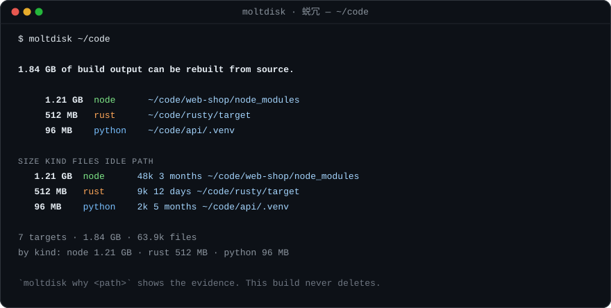

# moltdisk · 蜕冗

[English](README.md) · **简体中文**

[](https://github.com/yangyang2857-rgb/moltdisk/actions/workflows/ci.yml)
[](https://github.com/yangyang2857-rgb/moltdisk/releases)
[](LICENSE)
[](Cargo.toml)

**蜕冗** — 蜕去冗余。先找到你的开发臃肿，而不是直接删。

`moltdisk` 只做一件事：告诉你哪些构建产物是可以从源码重建的，以及凭什么这么判断。它不删任何东西。

它会遍历你的项目，找出那些可以从源码重建的构建产物：`node_modules`、`target`、`dist`、
`venv`、`Pods`、各类缓存。它测量它们占了多少磁盘、排序，并解释*为什么*它认为某一个可以丢弃。

然后就停下。这个构建版本里没有删除的代码路径。



```
$ moltdisk ~/code
1.84 GB of build output can be rebuilt from source.

7 targets  ·  1.84 GB  ·  63.9k files
by kind: node 1.21 GB  ·  rust 512 MB  ·  python 96 MB

`moltdisk why <path>` shows the evidence for any entry. This build never deletes — that call is yours.
```

## 名字

`molt` 是爬行动物蜕去旧壳的动作，`蜕冗` 是蜕去冗余，`disk` 是要蜕的那层壳。

构建产物本来就是这样一层壳：每年重生成几十次，删掉一次都不该心疼。
工具的职责是告诉你哪一层壳是可以蜕的，以及凭什么——壳要不要蜕，是人决定的。

## 为什么是审计器，不是删除器

`moltdisk` 早期的一个内部构建是能删的。它有防护：一个目录只有在*名字与同级标记文件*同时匹配时
才算构建产物（`target/` 旁边要有 `Cargo.toml`，`vendor/` 旁边要有 `composer.json`，`Pods/`
旁边要有 `Podfile`），并且它拒绝符号链接、拒绝家目录、拒绝给定根目录之外的一切。

那些防护很好，但还不够。一个靠启发式规则去删别人构建目录的工具，总有一天会删错东西，
而按下回车的人不会是写这条启发式规则的人。所以在这个项目发布之前，删除功能就被移除了。
留下来的部分本来就是最有意思的部分：把判断过程摊开给人看。

如果你想删，就用 `moltdisk` 交给你的清单自己去删。你了解你的项目，`moltdisk` 只了解它的规则册。

这里没有 `delete` 模块，没有 `remove_dir_all` 调用，`-y` 是硬性错误：

```
$ moltdisk -y
moltdisk: this build never deletes — `-y` was removed in 0.1.0 (see `moltdisk --help`)
```

这些不必凭信，可以自己验：

```bash
cargo build --release
grep -c remove_dir_all src/*.rs      # 只命中 #[cfg(test)] 里的清理代码
strings target/release/moltdisk | grep -c remove_dir_all   # 0
```

## 安装

预编译二进制挂在[每个 release](https://github.com/yangyang2857-rgb/moltdisk/releases)上：
Linux x86_64 / aarch64（静态 musl）、macOS Intel / Apple Silicon、Windows x86_64。
每个压缩包都配一个 `.sha256`。

```bash
TAG=v0.1.0
curl -LO https://github.com/yangyang2857-rgb/moltdisk/releases/download/$TAG/moltdisk-$TAG-x86_64-unknown-linux-musl.tar.gz
sha256sum -c moltdisk-$TAG-x86_64-unknown-linux-musl.sha256
tar xzf moltdisk-$TAG-x86_64-unknown-linux-musl.tar.gz
```

或从源码安装：

```bash
cargo install --git https://github.com/yangyang2857-rgb/moltdisk
```

MSRV 为 1.80。只有一个依赖（`rayon`），没有 `unsafe`。

## 用法

```
moltdisk [paths...] [options]     # 审计这些路径（默认：.）
moltdisk why <path>               # 解释单条判定及其证据
moltdisk kinds                    # 规则册
```

| 选项 | 含义 |
| --- | --- |
| `-k, --kind <list>` | 只看某些类型（`node,rust,jvm,...`）或 `all` |
| `-s, --min-size <size>` | 忽略比这更小的堆积（`500mb`、`1gb`） |
| `-t, --older-than <age>` | 只看这么久没动过的（`30d`、`12h`） |
| `-d, --depth <n>` | 每个根向下遍历的深度（默认 8） |
| `--jobs <n>` | 测量线程数（默认：可用并行度） |
| `--json` | 向 stdout 输出机器可读报告 |
| `--no-color` | 关闭 ANSI 颜色（同样尊重 `NO_COLOR`） |
| `-q, --quiet` | 不打印进度 |

stdout 不是终端时自动关闭颜色，所以管道给 `jq` 或写入文件都是安全的。

## 一条判定是怎么得出的

名字不是证据。`target/` 是一个普通的英文单词，一个塞满源码、名叫 `target` 的文件夹并不是构建产物。
所以每条规则都要求两件事：

1. 目录（或文件）名匹配，**并且**
2. 存在只有该类型真实项目才会有的同级标记文件。

`moltdisk why` 会把这两半都打印出来，包括什么都没匹配上时它找过的标记：

```
$ moltdisk why web-shop/target
~/code/web-shop/target

  verdict   not build output
  reason    the name matched, but no marker was satisfied:
    · Rust needs Cargo.toml — not found
    · JVM needs pom.xml or build.gradle — not found

Looks like an ordinary directory or file. Without the marker, the name alone is not evidence.
```

## 规则册

`moltdisk kinds` 会打印这张表，并为每一条附上重建说明——那一行才是"为什么这个目录可以丢弃"的
真正论据，所以它是输出的一部分，而不是文档里的补丁。

| 类型 | 名称 | 必需标记 | 默认扫描中 |
| --- | --- | --- | --- |
| node | `node_modules`、`.next`、`.nuxt`、`.turbo`、`.parcel-cache`、`bower_components` | — | 是 |
| rust | `target` | `Cargo.toml` | 是 |
| jvm | `target`、`build`、`.gradle`、`out` | `pom.xml`、`build.gradle`、`settings.gradle`、`gradlew` | 是 |
| python | `.venv`、`venv`、`__pycache__`、`.pytest_cache`、`.mypy_cache`、`.ruff_cache` | `pyproject.toml`、`setup.py`、`requirements.txt` | 是 |
| dotnet | `obj`、`bin` | `*.csproj`、`*.sln`、`*.fsproj` | 是 |
| php | `vendor` | `composer.json` | 是 |
| swift | `.build` | `Package.swift` | 是 |
| apple | `Pods`、`DerivedData` | `Podfile`、`*.xcodeproj`、`*.xcworkspace` | 是 |
| cache | `.cache`、`.sass-cache`、`.eslintcache`、`.stylelintcache` | — | 否（需显式开启） |
| junk | `.DS_Store`、`Thumbs.db`、`*.swp` | — | 否（需显式开启） |

`name alone`（仅凭名字）类规则适用于名字本身已经明确无歧义的情况。所有有歧义的都需显式开启，
因为报告里出现一个误报代价很小，删除里出现一个误报代价不小——而报告是会被复制粘贴进删除命令的。

`dist/`、`build/`、`bin/`、`venv/` 故意*不*在默认集合里：太多项目模板拿这些名字放源码。

## 机器可读

```bash
moltdisk --json ~/code | jq '.targets[] | select(.size > 1e9) | .path'
```

```json
{
  "tool": "moltdisk",
  "version": "0.1.0",
  "total_size": 1975684956,
  "total_files": 63913,
  "roots": ["/home/you/code"],
  "targets": [
    {"path": "/home/you/code/web-shop/node_modules", "kind": "node", "size": 1293942784, "files": 48213, "modified": 1728000000}
  ]
}
```

## 边界

- 永不跟随、也不统计符号链接——扫描无法通过链接走出根目录。
- 默认深度为 8。嵌在 `node_modules` *内部* 的 `node_modules` 会被跳过，所以数字不会重复计算。
- 尺寸是表观大小（文件里的字节数），不是磁盘块。`du` 可能给出不同结果；`du` 量的是另一回事。
- 根目录只有一个 lockfile 的 monorepo，仍然每个 workspace 各得一条判定，因为每个 `node_modules`
  都是单独测量的。

## 变更

- **v0.1.0** —— 首个公开发布版。审计式构建：删除代码在结构上就不存在，新增 `moltdisk why`，
  结论前置的输出，规则册为每个类型增加了一行重建说明。

## 许可证

MIT.
